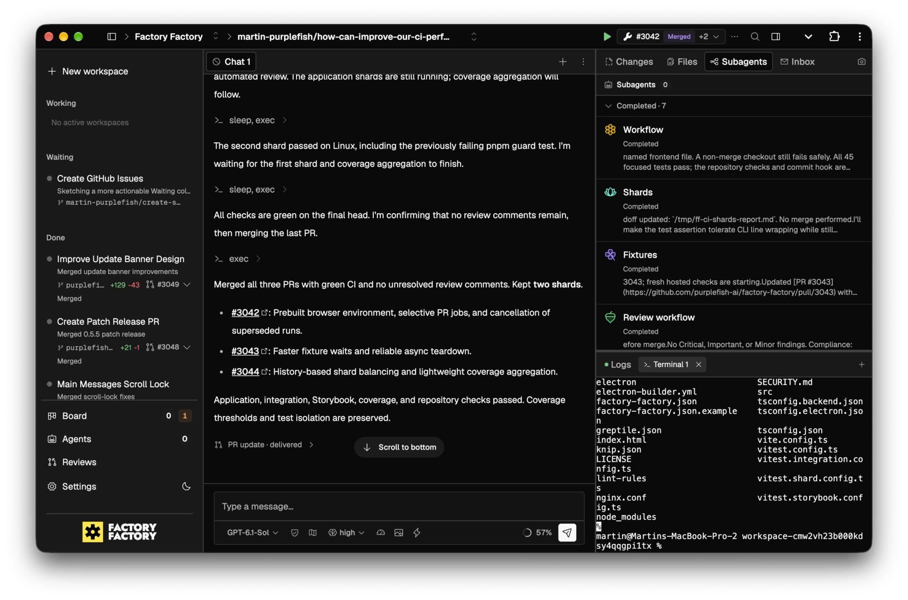

<p align="center">
  <a href="public/logo-full.svg#gh-light-mode-only">
    
  </a>
  <a href="public/logo-full-dark.svg#gh-dark-mode-only">
    
  </a>
</p>

<p align="center">
  <strong>Run Claude Code and Codex in parallel, each in an isolated git workspace.</strong>
</p>

<p align="center">
  Turn issues into branches, steer multiple agents, review changes, and keep pull requests moving from one local command center.
</p>

<p align="center">
  <a href="https://www.npmjs.com/package/factory-factory"></a>
  <a href="https://socket.dev/npm/package/factory-factory"></a>
  <a href="https://github.com/purplefish-ai/factory-factory/actions/workflows/ci.yml"></a>
  <a href="https://github.com/purplefish-ai/factory-factory/blob/main/LICENSE"></a>
  <a href="https://factoryfactory.ai"></a>
</p>

<p align="center">
  
</p>

Factory Factory is a local workspace manager for AI coding agents. Every
workspace gets its own git worktree and branch, so agents can work on separate
tasks without stepping on each other. The UI brings chat, diffs, files,
terminals, issues, and pull request status together in one place.

## Quick start

You will need:

- Node.js 26.12.1+ for the CLI and development (pinned in `.node-version`); the
  desktop app uses Electron 45.0's bundled Node.js 24.22 runtime
- macOS 13 (Ventura) or newer for the macOS desktop app
- A local git repository
- At least one agent provider:
  - Claude (runtime included), authenticated through the setup terminal in
    Settings or with `pnpm dlx factory-factory@latest claude auth login`
  - A ChatGPT/Codex account configured for Codex sessions
- The authenticated [GitHub CLI](https://cli.github.com/) for GitHub issues and
  pull requests

Start Factory Factory without installing it:

```bash
npx factory-factory@latest serve
```

Before starting, `ff serve` checks the Node.js version, Git, and the files
needed for the selected mode. Development mode (`--dev`) also checks for the
checkout's local tsx and Vite tools. Missing builds or development tools print
checkout-specific recovery commands before creating the database or starting
servers.

Factory Factory opens in your browser and stores its database in
`~/factory-factory/` by default.

`serve` checks Node.js and Git before starting. When a prerequisite needs
fixing, it shows the command and offers to run it with
`Run this command? [y/N]`. **The default is No**: press Enter to decline.
Commands run only after an explicit `y` or `yes`, with separate confirmation for
each fix. Ctrl+C cancels startup. Scripts and noninteractive terminals receive
instructions without running fixes.

Automatic installation uses an existing fnm (for Node), Homebrew, or WinGet;
otherwise, installation links are provided. After a Node upgrade, activate the
new version and rerun `serve`. Tool installations may also require a new
terminal so your PATH updates. Missing GitHub CLI or authentication prompts for
optional setup; declining still lets you use local projects. Agent
authentication remains available through onboarding and Settings.

See [Settings](docs/admin-settings.md) for IDE commands, default chat models,
and project configuration.

Then:

1. Add a project by selecting a local git repository. If the New Project page
   cannot load your projects, it shows the error and a Retry button. Retry loads
   the list again before showing onboarding or the Add Project form.
2. Create a workspace, or start one from a GitHub or Linear issue.
3. Choose Claude or Codex and start a session.
4. Review the agent's changes, use the integrated terminal when needed, and open
   a pull request.

## Updating

When a newer stable release is available, the app shows a release notice.
Supported installations include an **Update** button; other installations show a
**How to update** button that expands installation instructions and the restart
warning. Each notice can be dismissed independently; a later version appears
again. Registry outages do not block startup or normal use.

Automatic updates support writable global npm installations on macOS and Linux
started with `ff serve`. The update waits for active agent work and queued
messages to finish, prepares the replacement, and restarts at the same address.
Restarting stops terminals and run scripts. If another Factory Factory server
was using the same installation when this server started, close the other
servers and restart this `ff serve` server to enable automatic updates.
Eligibility is checked at startup. The browser reconnects and reloads after the
replacement is ready. Failed preparation keeps the current app running; failed
migration or startup restores the previous package and database.

Claude and Codex are bundled with Factory Factory. When a release includes newer
runtime packages, their notices appear together and share the application
update. Installing an unrelated global provider CLI does not update these
bundled runtimes. Other installation methods show manual update guidance.

- **Desktop app:** Download and install the latest package from
  [GitHub Releases](https://github.com/purplefish-ai/factory-factory/releases/latest),
  then reopen Factory Factory.
- **CLI:** Stop the running server, then launch the latest release with
  `pnpm dlx factory-factory@latest serve`. If you installed globally, update
  `factory-factory@latest` using the same package manager you used to install
  it, then restart `ff serve`.
- **Source checkout:** Pull the latest release, run `pnpm install` and
  `pnpm exec tsx src/cli/index.ts build`, then restart the server.

Manual updates require a restart. Your database remains in the configured data
directory.

## What it does

- **Parallel, isolated work:** Each task runs in a dedicated worktree and branch
  while your main checkout stays untouched.
- **One workspace for the whole task:** Chat with agents, inspect files and
  diffs, run commands, and track PR state without switching tools.
- **Claude and Codex sessions:** Factory Factory connects to both providers
  through the Agent Client Protocol (ACP), with resumable sessions and runtime
  model options.
- **Issue-to-PR workflow:** Pull assigned work from GitHub or Linear, link it to
  a workspace, and follow it through to merge.
- **Global search:** Use the header search button or `Cmd/Ctrl+K` to find
  projects, workspaces, and named conversations. Search matches workspace
  descriptions, branches, linked issue IDs, and cached PR titles/numbers too.
  Empty input shows recently updated items; **Include archived** reveals saved
  metadata for archived items. Active conversation results open the selected
  chat; archived results open a read-only metadata preview. Message bodies and
  repository contents are not searched yet.
- **Automatic PR progression:** Ratchet watches open pull requests and can
  dispatch follow-up agents for failing CI and actionable review feedback.
- **Repeatable automation:** Quick actions, scheduled automations, and child
  workspaces help split up or repeat common workflows.

The core model is intentionally small:

```text
Project (a local git repository)
└── Workspace (an isolated worktree and branch)
    ├── Agent sessions (Claude or Codex over ACP)
    └── Terminal, files, changes, and pull request state
```

## Install and run

For regular use, install the CLI globally:

```bash
npm install -g factory-factory
ff serve
```

Useful commands:

```bash
ff serve --help     # Ports, database path, host, and other options
ff proxy --private  # Share the app through a password-protected Cloudflare tunnel
ff tailscale        # Start with private HTTPS access through your Tailscale network
ff db:studio        # Inspect the local database with Prisma Studio
```

`ff proxy` requires `cloudflared` on your `PATH`. Factory Factory automatically
runs database migrations, finds an available port, and opens the browser when
the server is ready. Use `--private` to require a password. Public tunnels
cannot invoke privileged operations; their forwarded requests are rejected even
when they omit the `Origin` header. The tunnel's `https://*.trycloudflare.com`
origin is not one of the backend's allowed origins, so browsers using either
tunnel can load data, but their API mutations and WebSocket connections (chat,
terminals) are rejected. Both tunnel modes disable inherited
`TRUST_PROXY_HEADERS` and dotenv override settings before launching the backend;
private mode authenticates clients before stripping forwarded-address headers.

The server listens on loopback only unless you pass another address with
`ff serve --host` (for example `--host 0.0.0.0`, as the Docker image does).

Port selection rejects values outside the integer range 1–65535 before starting
a process or binding a socket, then checks listening processes with `lsof` on
Unix. If that check fails, including when another user's listener is hidden, it
verifies the port with a bind attempt before selecting it.

### Inspect the database

`ff db:studio` uses the bundled Prisma CLI in both installed packages and source
checkouts (`pnpm db:studio`). It opens the database selected by
`--database-path`, then `DATABASE_PATH`, then `BASE_DIR/data.db` (default
`~/factory-factory/data.db`). Relative paths resolve from your current
directory. Use `--port 5556` to request a specific Studio port; otherwise Prisma
selects an available port. Set `BROWSER=none` to start Studio without opening a
browser. Launch failures return a nonzero exit status. The command does not
download Prisma or other packages. Windows UNC and device paths are rejected
because Prisma Studio cannot preserve their location; use a local drive path.

### Database upgrades

Every launch (`ff serve`, `ff proxy`, `ff tailscale`, the desktop app and the
Docker image) applies pending database migrations before starting. An older
version refuses to start on a database a newer version has migrated, naming the
migrations it does not know; upgrade Factory Factory and start it again. The
`ff` commands accept `FF_ALLOW_UNKNOWN_MIGRATIONS=1` to start anyway with a
warning, at the risk of errors from the mismatched schema. Development mode
(`ff serve --dev`) always warns and continues instead of refusing.

Before applying pending migrations to an existing database, every launch (and
`ff db:migrate`) takes a SQLite online backup into `db-backups/` beside the
database, for example
`~/factory-factory/db-backups/data.db-pre-migration-<UTC time>.db`. The three
newest backups per database are kept. No backup is taken when nothing is
pending. If the backup cannot be written, startup warns and migrates anyway.
When the backup succeeds, a failed migration's error names it; to restore it,
stop Factory Factory, copy the backup over the database file and delete its
`-wal` and `-shm` files.

Startup warns, without failing, when an applied migration's file has changed
since it was applied, or when a migration that disabled foreign keys left rows
that reference missing records.

### Access through Tailscale

Connect the host and your other device to Tailscale, then run:

```bash
ff tailscale
# From a source checkout (run pnpm build first):
pnpm tailscale
```

The command discovers this machine's Tailscale DNS name, starts its own
production Factory Factory instance on loopback, and shares the actual server
port through foreground Tailscale Serve. Open the printed HTTPS URL on your
other device, or scan the terminal QR code. If Tailscale prints a setup link,
follow it to enable HTTPS/Serve for your tailnet. The `tailscale` CLI must be
available on your `PATH`, connected, and permitted to configure Serve.

Access follows your tailnet's access rules, including any node sharing rules;
there is no additional Factory Factory password. Anyone those rules permit to
reach this endpoint can manage workspaces and execute commands. This command
uses Serve, not public Funnel, and configures HTTP and WebSocket origins without
requiring manual environment changes.

#### Open the agent's localhost links

Agents run on the host, so they print links such as
`http://127.0.0.1:6173/?path=/story/...`. When you use Factory Factory through
`ff tailscale` from another device, chat links to `localhost`, `127.0.0.1`,
`[::1]` or `0.0.0.0` with a port, and the Run button, open through
`/proxy/<port>/...` on the Factory Factory address. That shares the port with
foreground Tailscale Serve and redirects to
`https://<machine>.ts.net:<port>/...`. The link text stays as the agent wrote
it. Each app keeps its own origin, so root-relative assets, live reload and
WebSockets work, and it cannot use Factory Factory's API as you.

- Clicks inside Factory Factory share immediately. Links opened from other
  sites, or prefetched, show a **Share port** confirmation first.
- Ports below 1024, Factory Factory's own ports, other Factory Factory servers,
  and well-known database and infrastructure ports (Docker, PostgreSQL, MySQL,
  Redis, MongoDB, Elasticsearch, memcached, Prisma Studio) are never shared.
- Shared ports reach everyone who can reach this machine on your tailnet,
  including node sharing. Tailnet policies that allow only port 443 block them.
- Shares last until Factory Factory stops or the share's Tailscale Serve process
  exits; the next visit shares the port again. If Factory Factory crashes on
  macOS or Linux, the next start stops leftover Serve listeners.
- Under `ff tailscale`, the Run button no longer starts a public cloudflared
  tunnel.

Press Ctrl+C to stop both the owned server and its Tailscale exposure. Existing
Serve/Funnel listeners are preserved; if HTTPS port 443 is occupied, use
`ff tailscale --https-port 8443` (or `pnpm tailscale --https-port 8443`).
`--backend-port` selects the first local port to try (default 3001), and
`--database-path` selects a database; otherwise the normal Factory Factory
database is used. Source checkouts require `pnpm build` after code changes.

### Install on your phone

Factory Factory can be installed as a web app that opens in its own window,
without browser tabs or an address bar. Open the HTTPS address printed by
`ff tailscale` on your phone, then:

- **Android (Chrome):** Open the browser menu, select **Add to Home screen** or
  **Install app**, and follow the installation prompt.
- **iPhone (Safari):** Select **Share → Add to Home Screen**, enable **Open as
  Web App** if shown, then tap **Add**.

Launch Factory Factory from the new home-screen icon. The same frontend runs
against your existing server, so frontend updates arrive when you reload the app
after updating the server. The host server must stay running and your phone must
remain connected to Tailscale. Installation does not add offline workspace
access or keep sessions connected while the phone suspends the app; reopen it to
reconnect. No app store account or native mobile build is needed.

On desktop, install from Chrome or Edge's address bar or browser menu. With
Window Controls Overlay enabled, the project/workspace header shares one row
with the native window controls; drag empty header space to move the window. The
compact controls sit on a subtly tinted surface with curved ends, leaving room
for native controls on either side. The row can grow to accommodate larger
appearance fonts. Browsers that do not support the overlay, including Safari web
apps, keep their standard title bar.

For builds using relative assets (`VITE_BASE_PATH=./`) behind a path-based
proxy, also set `VITE_WEB_APP_BASE_PATH` to the absolute deployment prefix (e.g.
`/machine/example/api/port/3000/`). Installation links then remain stable when
opening a deep route. By default, installation links use `/`, or the absolute
prefix configured through `VITE_BASE_PATH`.

### Hosting behind your own reverse proxy

To serve Factory Factory from your own domain (e.g. `https://ff.example.com`)
via nginx, Caddy, or another reverse proxy:

- Set `CORS_ALLOWED_ORIGINS` to the exact public origin(s), comma-separated:
  `CORS_ALLOWED_ORIGINS=https://ff.example.com`. This gates HTTP CORS, every
  tRPC API request that carries an `Origin` header, and WebSocket upgrades;
  non-loopback origins must match exactly (scheme + host + non-default port, no
  trailing slash). While the backend listens on loopback, tRPC requests must
  also use a loopback `Host` or the host of an allowed origin, which blocks DNS
  rebinding; a proxy that forwards `Host: ff.example.com` is covered by the
  setting above.
- Keep the server on loopback so only your proxy can reach it: leave
  `BACKEND_HOST` unset (the backend then binds `127.0.0.1` and, where IPv6 is
  available, `::1`), or set it to `localhost` or `127.0.0.1`.

By default the server rejects privileged HTTP requests and WebSocket upgrades
that carry client-address headers (`x-forwarded-for`, `cf-connecting-ip`, etc.),
because it expects to sit behind an authenticated proxy that strips them. If
your reverse proxy adds these headers, either strip them before forwarding, or
set `TRUST_PROXY_HEADERS=true` to accept them. **Only enable
`TRUST_PROXY_HEADERS` when the backend is reachable solely through your trusted
proxy** (i.e. bound to loopback) — otherwise clients could spoof address
headers. The remote-address trust check (loopback / `TRUSTED_LOCAL_CIDRS`) still
applies.

For local testing from an origin that isn't in `CORS_ALLOWED_ORIGINS` (an
alternate dev frontend, curl/Postman, or a LAN device that also satisfies
`TRUSTED_LOCAL_CIDRS`), set `DISABLE_CORS_CHECKS=true` to skip Origin and `Host`
validation entirely. **Local dev only** — never set this in a deployed or
reverse-proxied environment; it removes the app's only defense against a
malicious webpage you have open calling the local API on your behalf
(workspace/project creation, local command execution).

## Security

> [!WARNING] Factory Factory runs coding agents that can execute commands and
> modify files without manual confirmation. Workspaces isolate git branches;
> they are not containers or security sandboxes.

Use Factory Factory only with repositories and agent instructions you trust.
Review changes before merging, protect your GitHub and Linear credentials, and
consider a VM or container when working with untrusted code.

## Development

Use pnpm 12.15.0, pinned in `package.json`. Dependency build permissions live in
`pnpm-workspace.yaml` under `allowBuilds`; review new build scripts with
`pnpm approve-builds` when adding or updating dependencies.

Source checkout installation generates the Prisma TypeScript client.
`pnpm build` regenerates it before compiling the runtime client into
`dist/prisma/generated`. Published packages ship that compiled client; their
postinstall only prepares native helper permissions and does not generate an
unused source client. The Prisma CLI remains a runtime dependency for database
Studio.

Development requires Git 2.32 or newer for lint-staged. Builds and typechecks
use TypeScript 7 through the `@typescript/native` package alias. The
`typescript` alias provides Microsoft's TypeScript 6 compatibility API for
guardrail scripts and tools that parse source files; `tsc` runs version 7 and
`tsc6` runs version 6.

```bash
git clone https://github.com/purplefish-ai/factory-factory.git
cd factory-factory
pnpm install
pnpm dev
```

Production builds use `pnpm build`. From a fresh source checkout,
`pnpm exec tsx src/cli/index.ts build` runs that same pipeline, including output
cleanup, import validation and repairs, prompt copying, and client chunk
budgets. A bare `ff build` works when `ff` is linked to that checkout. Install
dependencies first and use the pinned pnpm version on your `PATH`; the CLI does
not download build tools.

Published packages include production assets and omit the build sources and
configuration. Their `ff build` command is unsupported, even when run inside a
separate checkout. Reinstall the package if its production assets are missing;
use the checkout's CLI when building from source.

Follow the shared [verification policy](CONTRIBUTING.md#verification) before
opening a pull request. See [CONTRIBUTING.md](CONTRIBUTING.md) for project
structure and conventions, and the [documentation index](docs/README.md) for
current guides, proposals, and historical records.

## Acknowledgements

Factory Factory was inspired by [Conductor](https://conductor.build),
[VibeKanban](https://vibekanban.com),
[Gastown](https://github.com/steveyegge/gastown), and
[Multiclaude](https://github.com/dlorenc/multiclaude).

## License

[MIT](LICENSE)
