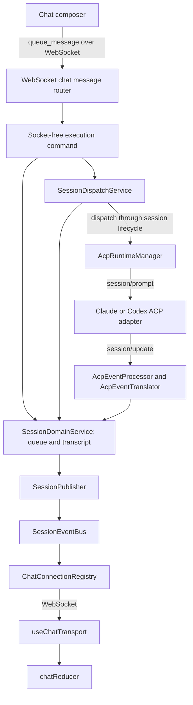

# Chat message flow

This note has moved. Read the
[chat feature guide](../src/client/features/chat/AGENTS.md) for the client's
ownership, invariants and map, and the records it links in
[decisions](decisions/) for the reasons. The tests the guide names describe the
behaviour.

The server side (what the session capsule sends, replays and publishes, and how
the WebSocket transport delivers it) has no guide yet. Its rules, hazards and
ownership statements are held below until those areas are migrated; their
behaviour is in the tests beside `src/backend/services/session/` and
`src/backend/routers/websocket/`.

This page remains while the section below holds entries; delete it when they are
gone.

## Held for other guides

Rules, hazards and reasons from the old note that belong to another area. Each
entry quotes only the sentences it needs from the paragraph named after it,
verbatim, with `[…]` where sentences between them are left out, and has not been
checked against the code. The migration that creates the named area's guide
checks the entry, moves what holds there and deletes the entry here. Paragraph
numbers are the rows of the disposition table in pull request #NNNN.

Old paragraph 4. For the session capsule guide's map; the client end is in the
chat feature guide.

> `chat-message-router.ts` composes the command registry at the WebSocket
> boundary from explicit application capabilities. Commands accept plain data
> and return typed outcomes; they receive no sockets.

Old paragraph 5. For a WebSocket router guide
(`src/backend/routers/websocket/`).

> Session composition configures one `SessionDispatchService`. The dispatcher
> owns queue execution, concurrent-dispatch tokens, busy-turn retry timers and
> attempts, and manual resume. `SessionLifecycleGate` owns lifecycle
> generations; the dispatcher applies its generation checks when validating
> dispatch eligibility and starting the runtime through injected capabilities.

Old paragraph 5. For the session capsule guide.

> The dispatcher uses notification and background-delivery capabilities for
> claims, preparation, validation, and completion. Those services retain claim
> and delivery authority; GitHub trigger interpretation remains outside queue
> execution. Workspace initialization, workspace notifications, PR delivery,
> lifecycle queue recovery, and prompt completion use the same dispatcher
> directly through their dispatch capabilities. Queue reset and manual resume
> callbacks also target that instance; the chat router has no dispatch facade.
> Application composition binds workspace startup, READY retries, child
> initialization, and live notification delivery to the supplied graph's
> dispatcher. Direct legacy orchestrator calls retain an explicit default
> dispatcher binding.

Old paragraph 6. For the session capsule guide.

> `AcpEventProcessor` translates provider updates with `AcpEventTranslator`,
> stores transcript changes, and emits session deltas. […] Runtime and
> permission events update session state through their respective handlers.

Old paragraph 7. For the session capsule guide.

> `SessionEventBus` is the transport-free outbound surface. `SessionPublisher`
> wraps incremental events in `session_delta`; `ChatConnectionRegistry` owns
> socket subscriptions, serialization, delivery, and logging of payloads that
> reach a client. The registry also supplies viewer counts to the domain through
> the bus.

Old paragraph 8. For the session capsule guide and a WebSocket router guide.

> `ChatEventForwarderService` handles workspace completion notifications and
> pending-request access. Agent stream translation belongs to the ACP processor;
> it does not attach legacy `ClaudeClient` listeners.

Old paragraph 9. For the session capsule guide.

> These leaf handlers receive no WebSocket and do not serialize frames.

Old paragraph 10. For the session capsule guide.

> `chat-command-adapter.ts` owns requester serialization and existing error
> copy.

Old paragraph 11. For a WebSocket router guide.

> The session configuration service serializes each configuration write through
> provider completion, persistence and state publication. When a live configured
> handle supplies confirmed options, a rejected change emits its configuration
> correction through `SessionDomainService.emitDelta` before releasing that
> write's queue slot. This prevents a delayed rollback from overwriting a newer
> successful choice. Inactive or unavailable-session failures can return an
> error without a configuration correction. Correction delivery is independent
> of the requester's connection; […] Permission completion and matching-request
> cleanup remain owned by the permission service.

Old paragraph 11. For the session capsule guide.

> Their lifecycle, domain, background-delivery and dispatcher capabilities are
> supplied by the transport composition from the application graph. Queue
> acceptance, rejection, and cancellation stay on the session-wide event
> channel; only requester errors are returned to the adapter.

Old paragraph 12. For the session capsule guide.

> Direct `user_input` still sends without waiting for a provider turn or
> background resume persistence. Start and queue acceptance also trigger
> background resume without awaiting it. Explicit queue resume awaits
> persistence and rechecks its captured generation before enabling manual
> dispatch. Stop awaits termination, clears pending interaction, resets dispatch
> state, and then retries the queue. The lifecycle and background-delivery
> owners retain generation and PR pause policy; commands coordinate those
> capabilities without taking ownership.

Old paragraph 13. For the session capsule guide.

> The load command uses explicit preparation, synchronous replay capture, and
> completion through `SessionLoadService`. Its preparation and replay are plain
> data. The transport adapter owns replay framing and requester error delivery.

Old paragraph 14. For the session capsule guide and a WebSocket router guide.

> Registering a chat WebSocket does not hydrate history.

Old paragraph 15. For a WebSocket router guide.

> History fences, transcript writes, hydration flags, and retry cooldowns use
> the same application domain that supplies replay. […] Capture and publication
> do not yield, so a queued live update cannot precede a stale replay.

Old paragraph 16. For the session capsule guide.

> The configuration owner performs at most one catalog lookup per completion,
> including failed discovery, and rechecks stored selection after discovery.
> Successful catalog reads still share their existing cache. A live handle owns
> capabilities; for compatibility, an empty live handle still permits stored
> fallback options. Passive reads never persist a catalog selection. If a
> prepared live handle retires before publication, another read supplies the
> durable fallback. Every retry is finalized again synchronously and reuses the
> same catalog attempt. Repeated runtime retirement fails before configuration
> publication or initial activation.

Old paragraph 17. For the session capsule guide.

> Socket subscriptions, serialization, safe delivery, and disconnected-viewer
> cleanup remain owned by the transport.

Old paragraph 18. For a WebSocket router guide.

> Serialization still happens before measurement, so the limit bounds outgoing
> frames rather than the cost of constructing authoritative state.

Old paragraph 20. For a WebSocket router guide.

> Load correlation IDs are bounded to 128 UTF-16 code units at admission so even
> escaped identifiers fit the small error envelope without losing correlation.
> Existing persisted/imported project IDs remain valid; snapshot errors omit an
> overlong project ID and use the current connection scope for HTTP fallback.
> […] Both keep the socket open and suppress subsequent baseline-dependent
> updates to the viewer missing its baseline. Independent command replies and
> workspace notifications remain available. Only a baseline accepted by that
> viewer can release the guard. They do not reconnect to the same rejected
> state.

Old paragraph 21. For a WebSocket router guide.

> The configured budget also bounds the logical replay; the existing 128 MiB
> replay assembly ceiling remains an absolute upper bound. […] Serialized replay
> storage is bounded by twice its declared source size plus 1 KiB per bounded
> chunk for base64/envelope overhead. […] Neither coalesced retries nor failed
> writes create OUT_TO_CLIENT records. These records describe successful local
> socket writes, not application-level peer receipts.

Old paragraph 22. For a WebSocket router guide.

> `SessionPublisher` also supports `session_snapshot`; loading is not split into
> an initial snapshot protocol and a separate reconnect protocol.

Old paragraph 25. For the session capsule guide.

> Provider history comes from the Claude or Codex history loader selected by the
> session's provider and identity. Concurrent loads, retries and an overlapping
> startup share one read, and reopening an idle session can reuse its cached
> projection while the history file is unchanged and the entry is retained; see
> [agent runtime](architecture/agent-runtime.md). Codex tool-history backfill
> defers transcript renumbering while a session is starting, running, or
> stopping, including turns that begin during the history read. This preserves
> the message orders used by live text deltas. A later idle load can recover the
> missing tools.

Old paragraph 26. For the session capsule guide.

> In-memory pending requests can survive a viewer reconnect while the session
> exists; they are not a durable permission request that can be resumed after a
> server restart.

Old paragraph 27. For the session capsule guide.

> Full snapshots remain for explicit `emitSessionSnapshot` calls, process exit,
> clearing queued work, provider-history reset, transcript removal, injected
> replay messages, and PR-delivery queue changes that also rewrite the
> transcript (enqueueing over a previous outcome or cancelling a queued update).

Old paragraph 31. For the session capsule guide.

> Backend senders are typed against `WebSocketMessage`; direct requester replies
> go through `serializeChatFrame`.

Old paragraph 32. For a WebSocket router guide.

> Questions and permissions are stored in
> `SessionStore.pendingInteractiveRequest` and included in replay. The
> permission service resolves responses and clears the matching pending request
> only after successful resolution, including for callers outside WebSocket
> handlers. Request IDs ensure an older response cannot clear a newer request;
> unresolved responses leave pending state unchanged.

Old paragraph 38. For the session capsule guide.

> Task creation also uses native content sizing, capped at 240 pixels. Browsers
> without native content sizing use one resize after the draft commits and
> restore internal scrolling after measurement; repeated height resets otherwise
> cause jumps once that cap is reached.

Old paragraph 48. For the Kanban feature guide (`src/client/features/kanban/`).

> The compatible archive reader is `ClosedSessionReadTranscriptSchema`
> (`closed-session-transcript-schema.ts`), built on `ArchivedJsonRecordSchema`;
> […] Preserving opaque legacy rows is the reader DTO's job; rendering their
> fallback happens in `closed-session-transcript-items.ts`.

Old paragraph 56. For the session capsule guide (closed-session archive).

> | Concern                                               | Source                                                                                                                                                                                                        |
> | ----------------------------------------------------- | ------------------------------------------------------------------------------------------------------------------------------------------------------------------------------------------------------------- |
> | Queue, transcript, runtime snapshot, pending requests | [SessionDomainService](../src/backend/services/session/service/session-domain.service.ts) and its `store/` collaborators                                                                                      |
> | Provider event translation                            | [AcpEventProcessor](../src/backend/services/session/service/events/acp-event-processor.ts)                                                                                                                    |
> | History hydration and replay                          | [SessionLoadService](../src/backend/services/session/service/chat/session-load.service.ts) and [provider history hydrator](../src/backend/services/session/service/data/session-provider-history-hydrator.ts) |
> | Outbound event envelopes                              | [SessionPublisher](../src/backend/services/session/service/store/session-publisher.ts)                                                                                                                        |
> | WebSocket subscriptions and delivery                  | [ChatConnectionRegistry](../src/backend/routers/websocket/chat-connection-registry.ts)                                                                                                                        |
> | Persisted provider identity and lifecycle history     | `AgentSession` and `SessionLifecycleEvent` in [Prisma schema](../prisma/schema.prisma)                                                                                                                        |

Old paragraph 59, every row but the client's. For the session capsule guide and
a WebSocket router guide.
