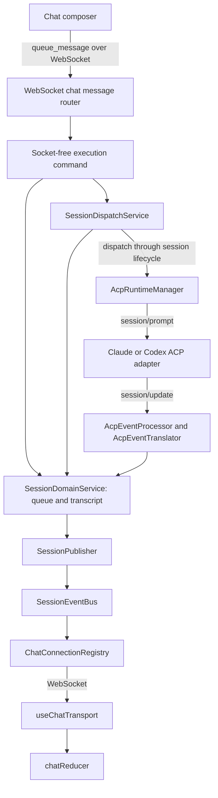

# Chat message flow

Claude and Codex share the ACP runtime and the same session event stream. For
provider startup, cancellation, and lifecycle ownership, see
[agent runtime](architecture/agent-runtime.md).

## Live messages

`chat-message-router.ts` composes the command registry at the WebSocket boundary
from explicit application capabilities. Commands accept plain data and return
typed outcomes; they receive no sockets. Session composition configures one
`SessionDispatchService`. The dispatcher owns queue execution,
concurrent-dispatch tokens, busy-turn retry timers and attempts, and manual
resume. `SessionLifecycleGate` owns lifecycle generations; the dispatcher
applies its generation checks when validating dispatch eligibility and starting
the runtime through injected capabilities. The queued message stays visible
until dispatch is ready, so refreshing during startup does not remove it from
the queue.

The dispatcher uses notification and background-delivery capabilities for
claims, preparation, validation, and completion. Those services retain claim and
delivery authority; GitHub trigger interpretation remains outside queue
execution. Workspace initialization, workspace notifications, PR delivery,
lifecycle queue recovery, and prompt completion use the same dispatcher directly
through their dispatch capabilities. Queue reset and manual resume callbacks
also target that instance; the chat router has no dispatch facade. Application
composition binds workspace startup, READY retries, child initialization, and
live notification delivery to the supplied graph's dispatcher. Direct legacy
orchestrator calls retain an explicit default dispatcher binding.

`AcpEventProcessor` translates provider updates with `AcpEventTranslator`,
stores transcript changes, and emits session deltas. Streaming text accumulates
under a stable message order so the client updates the existing message. Runtime
and permission events update session state through their respective handlers.

`SessionEventBus` is the transport-free outbound surface. `SessionPublisher`
wraps incremental events in `session_delta`; `ChatConnectionRegistry` owns
socket subscriptions, serialization, delivery, and logging of payloads that
reach a client. The registry also supplies viewer counts to the domain through
the bus.

`ChatEventForwarderService` handles workspace completion notifications and
pending-request access. Agent stream translation belongs to the ACP processor;
it does not attach legacy `ClaudeClient` listeners.

## Session commands

The `set_model`, `set_config_option`, `set_thinking_budget`, and
`permission_response` handlers take a plain `SessionCommandContext` and typed
message. Their injected capabilities perform session operations; their
`SessionCommandOutcome` describes requester replies. These leaf handlers receive
no WebSocket and do not serialize frames.

`chat-command-adapter.ts` owns requester serialization and existing error copy.
The session configuration service serializes each configuration write through
provider completion, persistence and state publication. When a live configured
handle supplies confirmed options, a rejected change emits its configuration
correction through `SessionDomainService.emitDelta` before releasing that
write's queue slot. This prevents a delayed rollback from overwriting a newer
successful choice. Inactive or unavailable-session failures can return an error
without a configuration correction. Correction delivery is independent of the
requester's connection; only the requester receives the error and its optional
request correlation ID. Explicit model capabilities replies are requester-only.
Permission completion and matching-request cleanup remain owned by the
permission service.

The `start`, `stop`, `user_input`, `queue_message`, `remove_queued_message`, and
`resume_queued_messages` commands use the same plain context and typed outcomes.
Their lifecycle, domain, background-delivery and dispatcher capabilities are
supplied by the transport composition from the application graph. Queue
acceptance, rejection, and cancellation stay on the session-wide event channel;
only requester errors are returned to the adapter.

Direct `user_input` still sends without waiting for a provider turn or
background resume persistence. Start and queue acceptance also trigger
background resume without awaiting it. Explicit queue resume awaits persistence
and rechecks its captured generation before enabling manual dispatch. Stop
awaits termination, clears pending interaction, resets dispatch state, and then
retries the queue. The lifecycle and background-delivery owners retain
generation and PR pause policy; commands coordinate those capabilities without
taking ownership.

The load command uses explicit preparation, synchronous replay capture, and
completion through `SessionLoadService`. Its preparation and replay are plain
data. The transport adapter owns replay framing and requester error delivery.

## Loading and reconnecting

Registering a chat WebSocket does not hydrate history. The client explicitly
sends `load_session`, whose transport adapter runs these application stages:

1. `prepareLoad` reads the `AgentSession`, hydrates provider history, and merges
   durable lifecycle events. History fences, transcript writes, hydration flags,
   and retry cooldowns use the same application domain that supplies replay.
2. `captureReplay` synchronously reads the current runtime, recovers interrupted
   tool calls for stopped sessions, and captures domain replay data. The adapter
   immediately publishes the `session_replay_batch` envelope on the existing
   session event bus, preserving `loadRequestId` and broadcast recipient scope.
   Capture and publication do not yield, so a queued live update cannot precede
   a stale replay.
3. `completeLoad` updates the runtime, publishes capabilities, configuration
   options, and cached slash commands in order, then consumes and dispatches any
   stored initial message through that application's dispatcher.

Socket subscriptions, serialization, safe delivery, and disconnected-viewer
cleanup remain owned by the transport. A closed or throwing requester does not
skip application completion or another viewer's load updates. Concurrent loads
retain their own request IDs and consume stored initial text once.

Passive loading does not initialize an ACP runtime. A stored initial message may
subsequently be enqueued and dispatched through the normal message path.

Replay reconstructs the renderer's transcript window, queued messages, runtime,
pending interactive request, and retained recent rejections. `SessionPublisher`
also supports `session_snapshot`; loading is not split into an initial snapshot
protocol and a separate reconnect protocol. `loadRequestId` associates responses
with the client's load request.

Provider history comes from the Claude or Codex history loader selected by the
session's provider and identity. In-memory pending requests can survive a viewer
reconnect while the session exists; they are not a durable permission request
that can be resumed after a server restart.

## Frontend updates

`useChatTransport` unwraps `session_delta` before passing its inner event to
`createActionFromWebSocketMessage`. The reducer handles snapshots and replay
batches as well as live events; replay uses the same event-to-action mapping.

| Wire event                                             | Reducer action or handling                             |
| ------------------------------------------------------ | ------------------------------------------------------ |
| `session_snapshot`                                     | `SESSION_SNAPSHOT`                                     |
| `session_replay_batch`                                 | `SESSION_REPLAY_BATCH`                                 |
| `agent_message`                                        | `WS_AGENT_MESSAGE`                                     |
| `assistant_text_delta`                                 | Incremental text update                                |
| `message_state_changed`                                | `MESSAGE_STATE_CHANGED`                                |
| `session_runtime_snapshot` / `session_runtime_updated` | `SESSION_RUNTIME_SNAPSHOT` / `SESSION_RUNTIME_UPDATED` |
| `user_question` / `permission_request`                 | Interactive request state                              |

Questions and permissions are stored in `SessionStore.pendingInteractiveRequest`
and included in replay. The permission service resolves responses and clears the
matching pending request only after successful resolution, including for callers
outside WebSocket handlers. Request IDs ensure an older response cannot clear a
newer request; unresolved responses leave pending state unchanged.

Main chat and quick chat use `useGroupedChatMessages` to retain stable tool
groups between updates. An unchanged message array and length return the cached
grouping before filtering, deduplication, or prefix scanning. Changing
duplicate-result filtering creates a new grouper. Message edits must replace the
array and changed message objects; in-place appends and truncation are detected
by length, but same-length in-place edits are unsupported.

## Sources of truth

| Concern                                               | Source                                                                                                                                                                                                             |
| ----------------------------------------------------- | ------------------------------------------------------------------------------------------------------------------------------------------------------------------------------------------------------------------ |
| Queue, transcript, runtime snapshot, pending requests | [SessionDomainService](../src/backend/services/session/service/session-domain.service.ts) and its `store/` collaborators                                                                                           |
| Provider event translation                            | [AcpEventProcessor](../src/backend/services/session/service/lifecycle/acp-event-processor.ts)                                                                                                                      |
| History hydration and replay                          | [SessionLoadService](../src/backend/services/session/service/chat/session-load.service.ts) and [provider history hydrator](../src/backend/services/session/service/lifecycle/session-provider-history-hydrator.ts) |
| Outbound event envelopes                              | [SessionPublisher](../src/backend/services/session/service/store/session-publisher.ts)                                                                                                                             |
| WebSocket subscriptions and delivery                  | [ChatConnectionRegistry](../src/backend/routers/websocket/chat-connection-registry.ts)                                                                                                                             |
| Client transport and event reduction                  | [useChatTransport](../src/client/features/chat/use-chat-transport.ts) and [chat reducer](../src/client/features/chat/reducer/index.ts)                                                                             |
| Persisted provider identity and lifecycle history     | `AgentSession` and `SessionLifecycleEvent` in [Prisma schema](../prisma/schema.prisma)                                                                                                                             |

Focused history and recovery coverage remains in `load-session.handler.test.ts`
and `load-session.handler.recovery.test.ts`.
`src/client/features/chat/reducer/result-dedup.test.ts` covers result
deduplication across live and replay paths. Consult the current tests for exact
ordering and recovery contracts rather than inferring guarantees from a diagram.
