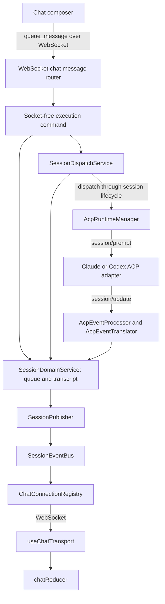

# Chat message flow

Claude and Codex share the ACP runtime and the same session event stream. For
provider startup, cancellation, and lifecycle ownership, see
[agent runtime](architecture/agent-runtime.md).

## Live thinking preview

Workspace chat and quick chat render live thinking in a reserved single-line
footer above the composer, outside the transcript viewport. The slot remains 32
pixels high while idle; only its opacity changes when activity starts or
finishes. Long previews truncate, with the full text available in a popover. The
inactive preview is inert, and closing its popover after completion does not
return focus to the inactive trigger. Reduced-motion preferences disable the
fade and spinner animation. Background processes, sub-agents, and goals retain
their transcript controls. Read-only transcripts retain the inline activity
presentation.

## Live messages

`chat-message-router.ts` composes the command registry at the WebSocket boundary
from explicit application capabilities. Commands accept plain data and return
typed outcomes; they receive no sockets. Session composition configures one
`SessionDispatchService`. The dispatcher owns queue execution,
concurrent-dispatch tokens, busy-turn retry timers and attempts, and manual
resume. `SessionLifecycleGate` owns lifecycle generations; the dispatcher
applies its generation checks when validating dispatch eligibility and starting
the runtime through injected capabilities. The queued message stays visible
until dispatch is ready, so refreshing during startup does not remove it from
the queue. The chat view keeps queued messages visible and cancellable alongside
the workspace or session startup status while hiding partial history replay.

The dispatcher uses notification and background-delivery capabilities for
claims, preparation, validation, and completion. Those services retain claim and
delivery authority; GitHub trigger interpretation remains outside queue
execution. Workspace initialization, workspace notifications, PR delivery,
lifecycle queue recovery, and prompt completion use the same dispatcher directly
through their dispatch capabilities. Queue reset and manual resume callbacks
also target that instance; the chat router has no dispatch facade. Application
composition binds workspace startup, READY retries, child initialization, and
live notification delivery to the supplied graph's dispatcher. Direct legacy
orchestrator calls retain an explicit default dispatcher binding.

`AcpEventProcessor` translates provider updates with `AcpEventTranslator`,
stores transcript changes, and emits session deltas. Streaming text accumulates
under a stable message order so the client updates the existing message. Runtime
and permission events update session state through their respective handlers.
The client renders the streaming message's Markdown from a throttled snapshot.
When the text splits safely into top-level blocks, only the growing tail block
re-parses; see [streaming Markdown](performance/streaming-markdown.md).

`SessionEventBus` is the transport-free outbound surface. `SessionPublisher`
wraps incremental events in `session_delta`; `ChatConnectionRegistry` owns
socket subscriptions, serialization, delivery, and logging of payloads that
reach a client. The registry also supplies viewer counts to the domain through
the bus.

`ChatEventForwarderService` handles workspace completion notifications and
pending-request access. Agent stream translation belongs to the ACP processor;
it does not attach legacy `ClaudeClient` listeners.

## Session commands

The `set_model`, `set_config_option`, `set_thinking_budget`, and
`permission_response` handlers take a plain `SessionCommandContext` and typed
message. Their injected capabilities perform session operations; their
`SessionCommandOutcome` describes requester replies. These leaf handlers receive
no WebSocket and do not serialize frames.

`chat-command-adapter.ts` owns requester serialization and existing error copy.
The session configuration service serializes each configuration write through
provider completion, persistence and state publication. When a live configured
handle supplies confirmed options, a rejected change emits its configuration
correction through `SessionDomainService.emitDelta` before releasing that
write's queue slot. This prevents a delayed rollback from overwriting a newer
successful choice. Inactive or unavailable-session failures can return an error
without a configuration correction. Correction delivery is independent of the
requester's connection; only the requester receives the error and its optional
request correlation ID. Explicit model capabilities replies are requester-only.
Permission completion and matching-request cleanup remain owned by the
permission service.

The `start`, `stop`, `user_input`, `queue_message`, `remove_queued_message`, and
`resume_queued_messages` commands use the same plain context and typed outcomes.
Their lifecycle, domain, background-delivery and dispatcher capabilities are
supplied by the transport composition from the application graph. Queue
acceptance, rejection, and cancellation stay on the session-wide event channel;
only requester errors are returned to the adapter.

Direct `user_input` still sends without waiting for a provider turn or
background resume persistence. Start and queue acceptance also trigger
background resume without awaiting it. Explicit queue resume awaits persistence
and rechecks its captured generation before enabling manual dispatch. Stop
awaits termination, clears pending interaction, resets dispatch state, and then
retries the queue. The lifecycle and background-delivery owners retain
generation and PR pause policy; commands coordinate those capabilities without
taking ownership.

The load command uses explicit preparation, synchronous replay capture, and
completion through `SessionLoadService`. Its preparation and replay are plain
data. The transport adapter owns replay framing and requester error delivery.

## Loading and reconnecting

Registering a chat WebSocket does not hydrate history. The client explicitly
sends `load_session`, whose transport adapter runs these application stages:

1. `prepareLoad` reads the `AgentSession`, hydrates provider history, and merges
   durable lifecycle events. History fences, transcript writes, hydration flags,
   and retry cooldowns use the same application domain that supplies replay.
2. `captureReplay` synchronously reads the current runtime, recovers interrupted
   tool calls for stopped sessions, and captures domain replay data. The adapter
   immediately publishes the `session_replay_batch` envelope on the existing
   session event bus, preserving `loadRequestId` and broadcast recipient scope.
   Capture and publication do not yield, so a queued live update cannot precede
   a stale replay.
3. `completeLoad` updates the runtime and resolves one configuration projection.
   It synchronously finalizes that read against the current live handle,
   publishes capabilities then nonempty configuration options without yielding,
   then awaits and publishes cached slash commands. It consumes and dispatches
   any stored initial message through that application's dispatcher only after
   commands.

The configuration owner performs at most one catalog lookup per completion,
including failed discovery, and rechecks stored selection after discovery.
Successful catalog reads still share their existing cache. A live handle owns
capabilities; for compatibility, an empty live handle still permits stored
fallback options. Passive reads never persist a catalog selection. If a prepared
live handle retires before publication, another read supplies the durable
fallback. Every retry is finalized again synchronously and reuses the same
catalog attempt. Repeated runtime retirement fails before configuration
publication or initial activation.

Socket subscriptions, serialization, safe delivery, and disconnected-viewer
cleanup remain owned by the transport. A closed or throwing requester does not
skip application completion or another viewer's load updates. Concurrent loads
retain their own request IDs and consume stored initial text once.

Chat and snapshot delivery use a stateful send policy. A viewer that exceeds 1
MiB of accumulated outgoing backlog is retired with close code 1013, then
terminated after five seconds if its close handshake has not completed. No
further state is sent on that connection, even if the buffer later drains.
Synchronous and asynchronous write failures also retire that viewer. Other
viewers and application work continue; reconnect runs the existing correlated
load/replay or current full-snapshot path.

A full snapshot, session snapshot, or legacy replay batch can exceed the
ordinary backlog budget on an empty connection. `WEBSOCKET_MAX_FRAME_BYTES`,
read through `configService`, sets its absolute UTF-8 frame ceiling: **32 MiB by
default** (33554432 bytes). Valid overrides are integer byte counts from 1 MiB
through 256 MiB, inclusive; missing or invalid values use the default. This
permits realistic large history/project baselines while bounding queued state
per viewer. Serialization still happens before measurement, so the limit bounds
outgoing frames rather than the cost of constructing authoritative state.

Load correlation IDs are bounded to 128 UTF-16 code units at admission so even
escaped identifiers fit the small error envelope without losing correlation.
Existing persisted/imported project IDs remain valid; snapshot errors omit an
overlong project ID and use the current connection scope for HTTP fallback. An
excessive replay returns a small `error` with code 413 and the requesting
`loadRequestId`; the client ends loading, cancels automatic load retries and
keeps unhydrated controls disabled. Other already-hydrated viewers keep their
live updates. An excessive project baseline returns `snapshot_error` with
`FRAME_TOO_LARGE`; the client shows its explanation and refreshes via the
existing HTTP fallback. Both keep the socket open and suppress subsequent
baseline-dependent updates to the viewer missing its baseline. Independent
command replies and workspace notifications remain available. Only a baseline
accepted by that viewer can release the guard. They do not reconnect to the same
rejected state. Increase the configured limit within its supported range,
restart the backend, and explicitly reconnect to retry; snapshots remain
available over HTTP. A successfully accepted baseline releases that guard.

Replay retains the responsive history loading and 128 KiB wire chunks. Chunk
envelopes carry the bounded load correlation ID, including the byte-fragment
fallback for unusually large replay metadata. The configured budget also bounds
the logical replay; the existing 128 MiB replay assembly ceiling remains an
absolute upper bound. A viewer queues one bounded replay sequence, writes one
chunk at a time as local write callbacks finish, and holds at most 1 MiB of
dependent updates until the complete baseline is written. Serialized replay
storage is bounded by twice its declared source size plus 1 KiB per bounded
chunk for base64/envelope overhead. Independent command replies and
notifications remain available. A retry of the same pending load reuses its
sequence; a newer distinct request explicitly supersedes and settles the older
request with a correlated 409 error. Neither coalesced retries nor failed writes
create OUT_TO_CLIENT records. These records describe successful local socket
writes, not application-level peer receipts.

A large full frame's write callback releases its allowance. Completion metadata
and subsequent deltas share an additional 1 MiB budget. Close, successful flush,
and retirement clean up listeners, pending queues and termination timers.
Snapshot deltas still wait for the full baseline to be admitted, and replay
keeps its existing request IDs, message identities and ordering.

Passive loading does not initialize an ACP runtime. A stored initial message may
subsequently be enqueued and dispatched through the normal message path.

Replay reconstructs the renderer's transcript window, queued messages, runtime,
pending interactive request, and retained recent rejections. `SessionPublisher`
also supports `session_snapshot`; loading is not split into an initial snapshot
protocol and a separate reconnect protocol. `loadRequestId` associates responses
with the client's load request. Snapshots for a session nobody is viewing are
not built, since a viewer that arrives later hydrates through `load_session`;
load replies are always sent.

Provider history comes from the Claude or Codex history loader selected by the
session's provider and identity. Codex tool-history backfill defers transcript
renumbering while a session is starting, running, or stopping, including turns
that begin during the history read. This preserves the message orders used by
live text deltas. A later idle load can recover the missing tools.

In-memory pending requests can survive a viewer reconnect while the session
exists; they are not a durable permission request that can be resumed after a
server restart.

## Targeted state deltas

Queue, commit, and interactive-request changes publish small `session_delta`
events instead of a full `session_snapshot`, which would rebuild, serialize, and
resend the whole transcript window (up to 1,000 messages) to every viewer:

- `queue_updated` carries the complete queue after an enqueue, removal, dequeue,
  or requeue.
- `transcript_message_committed` carries one committed transcript entry and the
  queue that remains after it. Batched dispatch and steering publish one per
  committed message.
- `pending_request_updated` carries the current pending interactive request, or
  `null` once it is resolved or cleared. The `permission_request` and
  `user_question` deltas still announce the prompt itself.

Each carries the authoritative value for the state it changes, so the client
replaces that state rather than patching it, and applying the delta matches what
a snapshot would show for those fields. Ordering relies on the same per-viewer
FIFO delivery as every other delta: the domain mutates the store and publishes
synchronously, and a viewer that is loading receives these deltas after its
replay. `src/shared/acp-protocol/protocol/session-state-delta-schema.ts`
validates them at the client transport boundary; the committed entry uses
`ArchivedChatMessageSchema`.

Full snapshots remain for explicit `emitSessionSnapshot` calls, process exit,
clearing queued work, provider-history reset, transcript removal, injected
replay messages, and PR-delivery queue changes that also rewrite the transcript
(enqueueing over a previous outcome or cancelling a queued update). Snapshots
for a session nobody is viewing are still skipped.

## Frontend updates

`useChatTransport` unwraps `session_delta` before passing its inner event to
`createActionFromWebSocketMessage`. The reducer handles snapshots and replay
batches as well as live events; replay uses the same event-to-action mapping.

| Wire event                                             | Reducer action or handling                             |
| ------------------------------------------------------ | ------------------------------------------------------ |
| `session_snapshot`                                     | `SESSION_SNAPSHOT`                                     |
| `session_replay_batch`                                 | `SESSION_REPLAY_BATCH`                                 |
| `agent_message`                                        | `WS_AGENT_MESSAGE`                                     |
| `assistant_text_delta`                                 | Incremental text update                                |
| `message_state_changed`                                | `MESSAGE_STATE_CHANGED`                                |
| `session_runtime_snapshot` / `session_runtime_updated` | `SESSION_RUNTIME_SNAPSHOT` / `SESSION_RUNTIME_UPDATED` |
| `user_question` / `permission_request`                 | Interactive request state                              |
| `queue_updated`                                        | `QUEUE_UPDATED`                                        |
| `transcript_message_committed`                         | `TRANSCRIPT_MESSAGE_COMMITTED`                         |
| `pending_request_updated`                              | `PENDING_REQUEST_UPDATED`                              |

Questions and permissions are stored in `SessionStore.pendingInteractiveRequest`
and included in replay. The permission service resolves responses and clears the
matching pending request only after successful resolution, including for callers
outside WebSocket handlers. Request IDs ensure an older response cannot clear a
newer request; unresolved responses leave pending state unchanged.

Main chat and quick chat use `useGroupedChatMessages` to retain stable tool
groups between updates. An unchanged message array and length return the cached
grouping before filtering, deduplication, or prefix scanning. Changing
duplicate-result filtering creates a new grouper. Message edits must replace the
array and changed message objects; in-place appends and truncation are detected
by length, but same-length in-place edits are unsupported.

The composer draft lives in the same chat state as the transcript, so every
keystroke re-renders `ChatContent`. `ChatTranscript` is memoized and skips those
renders only while its props keep their identity: the transcript header, running
sub-agent list, sub-agent callbacks and list state are memoized from the data
they show. Inside the transcript, the virtualizer's `getItemKey` and
`rangeExtractor` change only when the row key values change, because a new
`getItemKey` rebuilds every row measurement.

The renderer keeps a recent transcript window of
`DEFAULT_RENDERER_TRANSCRIPT_LIMIT` messages. Snapshots and replay arrive
trimmed to the limit; live appends then grow the window by up to a tenth of the
limit before it is trimmed back to the limit at a render-safe start. Between
trims the window start stays fixed, so lookups, grouping and the scroll
controller treat each update as an append instead of rebuilding for a moved
front. Messages that sort before the window start are dropped once the window
exceeds the limit, as with a strict trim.

Tool activity starts collapsed behind a category summary such as “Read files,
ran commands”. A single read shows “Read file Button.tsx”; a single command
shows its executable and, for recognized command-line tools, its first
subcommand, such as “Ran python3” or “Ran git cherry-pick”. Shell wrappers such
as `sh -ec 'git status'` show the underlying command, “Ran git status”.
Summaries omit command arguments and directory paths. Multiple reads or commands
use the generic plural labels. Expanding the summary reveals chronological
actions; each action expands to its full input and output. A summary with failed
actions ends with a danger-toned count, such as “Ran commands · 1 of 3 failed”
(or “· failed” for a single action), and shows an error icon once nothing is
pending. Pending activity keeps its running indicator.

The current session runtime error is pinned in a strip above the composer, not
in the scrolling transcript, so it stays visible in long chats. The strip
announces the error as an alert and offers **Retry**, **Restart agent** and
**Copy error**. Retry resends the newest sent user message with its attachments,
leaving the composer draft alone; sending also restarts a stopped runtime. Retry
is hidden when there is no sent message and disabled while disconnected or while
a send awaits confirmation. Restart uses the session restart action, which
resumes the provider conversation without sending anything. Dismissing hides the
strip until the error message changes or the error clears. Error lifecycle rows
in the transcript start as one line and expand inline to the full, selectable
text with a copy button; warning rows wrap.

Running sub-agent, background-process and completed sub-agent disclosures
remember explicit expand/collapse choices per session in browser memory,
including across navigation and temporary activity gaps. Reloading the page
resets these choices. Mounted disclosures retain their choices; the shared cache
retains up to 500 unmounted choices. Tool-call and file-tree expansion retain
their existing local-storage persistence.

Thinking-only assistant messages and thinking stream blocks are omitted from the
grouped transcript, including loaded session history. They do not create empty
rows. The live activity indicator still shows the latest reasoning while the
agent is running. Thinking deltas accumulate only within the current sequence:
legacy message starts (`message_start`), new thinking blocks, assistant text,
and tool starts clear the previous preview. Tool results and duplicate
deliveries of text or tool starts do not clear newer reasoning, even after those
messages leave the renderer window. A thinking-order watermark survives trimming
and user turns, and resets with session replay or switching. Snapshots seed it
from agent orders, excluding queued user orders. The fixed-height footer shows
the latest paragraph as plain text; its popup preserves the current sequence's
paragraphs with the same Markdown cleanup, retaining identifiers, bullet
markers, and literal code. Stale or repeated thinking deltas are ignored before
updating either transcript blocks or previews. A block start and its first delta
may share an order; later deltas must advance it. Partial Markdown markers do
not hide the latest readable paragraph. Inline activity indicators retain all
paragraphs.

## Transcript scrolling

Main chat, quick chat and subagent transcripts use the chat feature's
`ChatTranscript` surface. It owns the viewport, jump control, input observation
and virtualizer. Callers supply a workspace/session/surface identity,
visibility, hydration readiness, and optional committed-position persistence.
They must not add message-count scroll effects or composer-height scroll writes.

The chat composer reserves one line of its current font plus vertical padding as
its minimum height. With native `field-sizing: content`, a smaller minimum lets
Chromium briefly shrink an empty textarea, clamping the transcript's scroll
position even when its final viewport height is unchanged. Task creation also
uses native content sizing, capped at 240 pixels. Browsers without native
content sizing use one resize after the draft commits and restore internal
scrolling after measurement; repeated height resets otherwise cause jumps once
that cap is reached.

The scroll controller separates following from reading and from the suspended,
restoring and ready lifecycle. Layout changes cannot change intent. Upward input
yields immediately; downward movement within 24 pixels of the end or the jump
control resumes following. Sending a message in main chat or quick chat also
returns to the bottom and follows subsequent output. `useTranscriptSend` passes
a session-scoped request token to the controller, including for queued messages,
voice submissions and retries; ordinary incoming messages preserve reading
intent. A held touch/scrollbar gesture inhibits automatic positioning until
release, even if an older scroll operation emits `scrollend`. Explicit sends and
the jump control override that inhibition.

The virtualizer uses start anchoring with native append-follow disabled. One
controller frame coalesces committed content/viewport changes; TanStack performs
measured positioning and above-viewport compensation. A leading header stays
mounted so offscreen image/banner changes remain measured. ResizeObserver
batches run through the virtualizer's frame scheduler to avoid delivery loops
when compensation mounts more rows. Headers and the final message's activity
tail, inline tasks and subagent recovery status share the measured extent.
Native CSS anchoring is disabled on the controlled viewport. The jump button
overlays the bottom of the viewport above the reserved thinking footer, so
showing it cannot change the viewport's height or add a blank row above the
composer. Only the button intercepts pointer input; the surrounding overlay
allows interaction with the transcript beneath it.

Canceled PR records remain available for recovery but do not create virtual
rows. The empty state uses the filtered message model.

Returning to a pane restores follow intent or a keyed visible-row offset. Row
offsets are signed: a position in a gap anchors to the next visible row, keeping
that gap stable across prepends and restores. Main chat stores validated
optional `chatPosition` fields in the existing v1 workspace scroll records,
adapting legacy pixel/follow records. Quick chat keeps only sheet-owner memory;
subagent tabs use workspace-owned keyed positions that survive pane unmounts.
Closing a session revokes saved-position callbacks before removing its record.
Session switching never samples the previous session from the next session's
DOM.

Main readiness requires both workspace storage readiness and a matching
`runtimeSessionId`; runtime phase alone can change before history hydration.
Hidden, zero-size and hydrating panes suspend positioning and persistence.
Reading restores mount a keyed target, wait for a valid node/width measurement,
then refine its offset. A stalled restore cancels native commands after twelve
attempts and waits for fresh measurement readiness; exhausting the budget does
not persist an intermediate position. Anchoring inside a growing tool group is
relative to its grouped row, rather than to a particular tool call within it.

The `scrollToFn` provenance adapter is characterized against locked virtual-core
3.19.9: command/reconciliation writes specify behavior; deferred compensation
flushes and clamp retries can omit both behavior and adjustments. Those writes
remain allowed after command cancellation. Re-run the engine contract tests when
upgrading the virtualizer; do not infer write provenance from `isTrusted` or a
one-frame programmatic flag.

`pnpm test:e2e:scroll` runs the live transcript/installed virtualizer browser
checks against the development-only `/__transcript-scroll` fixture. It uses
local deterministic data, the real persistence adapter and no agent/backend.
`pnpm exec playwright test --config=playwright.chat.config.ts` covers real
composer expansion, attachments, prompts and jump-button reachability in
Storybook. The iOS-branch engine characterization exercises deferred writes; it
does not substitute for checking momentum behavior on an actual iOS device.

## Passive archive message validation

The archive-focused `ArchivedChatMessageSchema` and `ArchivedAgentMessageSchema`
in `src/shared/acp-protocol/protocol/archived-message-schema.ts` validate the
complete current serialized message structure. The compatible archive reader is
`ClosedSessionReadTranscriptSchema` (`closed-session-transcript-schema.ts`),
built on `ArchivedJsonRecordSchema`; the live `transcript_message_committed`
delta uses `ArchivedChatMessageSchema` to validate its committed entry. Unknown
message/content/stream tags and malformed current fields reject. Preserving
opaque legacy rows is the reader DTO's job; rendering their fallback happens in
`closed-session-transcript-items.ts`.

Tool inputs, tool schemas and result values use JSON-valued records/values:
functions, errors, cycles and nested `undefined` are outside the serialized
archive scope. Declared optional properties can remain absent or explicitly
`undefined` before serialization. The codec preserves every declared present
rich field without adding source/tag coupling, date formats, numeric positivity
or order constraints. Its tests compare recursive declared field paths and rich
roundtrips as well as output assignability, so optional additions cannot
silently be stripped.

JSON records validate entries recursively and reconstruct with
`Object.fromEntries`, preserving own `__proto__` keys as data without changing
object prototypes. Standard Zod JSON/record parsing strips that key, so it
cannot provide the archive's lossless tool-record or model-name boundary.

## Sources of truth

| Concern                                               | Source                                                                                                                                                                                                             |
| ----------------------------------------------------- | ------------------------------------------------------------------------------------------------------------------------------------------------------------------------------------------------------------------ |
| Queue, transcript, runtime snapshot, pending requests | [SessionDomainService](../src/backend/services/session/service/session-domain.service.ts) and its `store/` collaborators                                                                                           |
| Provider event translation                            | [AcpEventProcessor](../src/backend/services/session/service/lifecycle/acp-event-processor.ts)                                                                                                                      |
| History hydration and replay                          | [SessionLoadService](../src/backend/services/session/service/chat/session-load.service.ts) and [provider history hydrator](../src/backend/services/session/service/lifecycle/session-provider-history-hydrator.ts) |
| Outbound event envelopes                              | [SessionPublisher](../src/backend/services/session/service/store/session-publisher.ts)                                                                                                                             |
| WebSocket subscriptions and delivery                  | [ChatConnectionRegistry](../src/backend/routers/websocket/chat-connection-registry.ts)                                                                                                                             |
| Client transport and event reduction                  | [useChatTransport](../src/client/features/chat/use-chat-transport.ts) and [chat reducer](../src/client/features/chat/reducer/index.ts)                                                                             |
| Persisted provider identity and lifecycle history     | `AgentSession` and `SessionLifecycleEvent` in [Prisma schema](../prisma/schema.prisma)                                                                                                                             |

Focused history and recovery coverage remains in `load-session.handler.test.ts`
and `load-session.handler.recovery.test.ts`.
`src/client/features/chat/reducer/result-dedup.test.ts` covers result
deduplication across live and replay paths. Consult the current tests for exact
ordering and recovery contracts rather than inferring guarantees from a diagram.

## Message text selection

User and assistant messages use native text selection for copying on mobile and
desktop. Message rows have no copy buttons; rewind and queued-message actions
remain available.
