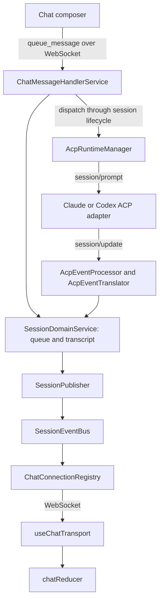

# Chat message flow

Claude and Codex share the ACP runtime and the same session event stream. For
provider startup, cancellation, and lifecycle ownership, see
[agent runtime](architecture/agent-runtime.md).

## Live messages

`ChatMessageHandlerService` validates dispatch eligibility and starts the
runtime when needed. The queued message stays visible until dispatch is ready,
so refreshing during startup does not remove it from the queue.

`AcpEventProcessor` translates provider updates with `AcpEventTranslator`,
stores transcript changes, and emits session deltas. Streaming text accumulates
under a stable message order so the client updates the existing message. Runtime
and permission events update session state through their respective handlers.

`SessionEventBus` is the transport-free outbound surface. `SessionPublisher`
wraps incremental events in `session_delta`; `ChatConnectionRegistry` owns
socket subscriptions, serialization, delivery, and logging of payloads that
reach a client. The registry also supplies viewer counts to the domain through
the bus.

`ChatEventForwarderService` handles workspace completion notifications and
pending-request access. Agent stream translation belongs to the ACP processor;
it does not attach legacy `ClaudeClient` listeners.

## Loading and reconnecting

Registering a chat WebSocket does not hydrate history. The client explicitly
sends `load_session`, whose handler:

1. Reads the `AgentSession` and hydrates provider history when needed.
2. Merges durable lifecycle events and recovers interrupted tool calls when the
   runtime is stopped.
3. Calls
   `sessionDomainService.subscribe({ sessionId, sessionRuntime, loadRequestId })`,
   which publishes a `session_replay_batch` and a runtime update.
4. Sends capabilities, configuration options, and cached slash commands.

Passive loading does not initialize an ACP runtime. A stored initial message may
subsequently be enqueued and dispatched through the normal message path.

Replay reconstructs the renderer's transcript window, queued messages, runtime,
pending interactive request, and retained recent rejections. `SessionPublisher`
also supports `session_snapshot`; loading is not split into an initial snapshot
protocol and a separate reconnect protocol. `loadRequestId` associates responses
with the client's load request.

Provider history comes from the Claude or Codex history loader selected by the
session's provider and identity. In-memory pending requests can survive a viewer
reconnect while the session exists; they are not a durable permission request
that can be resumed after a server restart.

## Frontend updates

`useChatTransport` unwraps `session_delta` before passing its inner event to
`createActionFromWebSocketMessage`. The reducer handles snapshots and replay
batches as well as live events; replay uses the same event-to-action mapping.

| Wire event                                             | Reducer action or handling                             |
| ------------------------------------------------------ | ------------------------------------------------------ |
| `session_snapshot`                                     | `SESSION_SNAPSHOT`                                     |
| `session_replay_batch`                                 | `SESSION_REPLAY_BATCH`                                 |
| `agent_message`                                        | `WS_AGENT_MESSAGE`                                     |
| `assistant_text_delta`                                 | Incremental text update                                |
| `message_state_changed`                                | `MESSAGE_STATE_CHANGED`                                |
| `session_runtime_snapshot` / `session_runtime_updated` | `SESSION_RUNTIME_SNAPSHOT` / `SESSION_RUNTIME_UPDATED` |
| `user_question` / `permission_request`                 | Interactive request state                              |

Questions and permissions are stored in `SessionStore.pendingInteractiveRequest`
and included in replay. Responses resolve through the permission service;
request IDs ensure clearing an older response does not remove a newer request.

Main chat and quick chat use `useGroupedChatMessages` to retain stable tool
groups between updates. An unchanged message array and length return the cached
grouping before filtering, deduplication, or prefix scanning. Changing
duplicate-result filtering creates a new grouper. Message edits must replace the
array and changed message objects; in-place appends and truncation are detected
by length, but same-length in-place edits are unsupported.

## Sources of truth

| Concern                                               | Source                                                                                                                                                                                                                                      |
| ----------------------------------------------------- | ------------------------------------------------------------------------------------------------------------------------------------------------------------------------------------------------------------------------------------------- |
| Queue, transcript, runtime snapshot, pending requests | [SessionDomainService](../src/backend/services/session/service/session-domain.service.ts) and its `store/` collaborators                                                                                                                    |
| Provider event translation                            | [AcpEventProcessor](../src/backend/services/session/service/lifecycle/acp-event-processor.ts)                                                                                                                                               |
| History hydration and replay                          | [Load handler](../src/backend/services/session/service/chat/chat-message-handlers/handlers/load-session.handler.ts) and [provider history hydrator](../src/backend/services/session/service/lifecycle/session-provider-history-hydrator.ts) |
| Outbound event envelopes                              | [SessionPublisher](../src/backend/services/session/service/store/session-publisher.ts)                                                                                                                                                      |
| WebSocket subscriptions and delivery                  | [ChatConnectionRegistry](../src/backend/routers/websocket/chat-connection-registry.ts)                                                                                                                                                      |
| Client transport and event reduction                  | [useChatTransport](../src/client/features/chat/use-chat-transport.ts) and [chat reducer](../src/client/features/chat/reducer/index.ts)                                                                                                      |
| Persisted provider identity and lifecycle history     | `AgentSession` and `SessionLifecycleEvent` in [Prisma schema](../prisma/schema.prisma)                                                                                                                                                      |

Focused load and recovery coverage lives beside the load handler in
`load-session.handler.test.ts` and `load-session.handler.recovery.test.ts`.
`src/client/features/chat/reducer/result-dedup.test.ts` covers result
deduplication across live and replay paths. Consult the current tests for exact
ordering and recovery contracts rather than inferring guarantees from a diagram.
